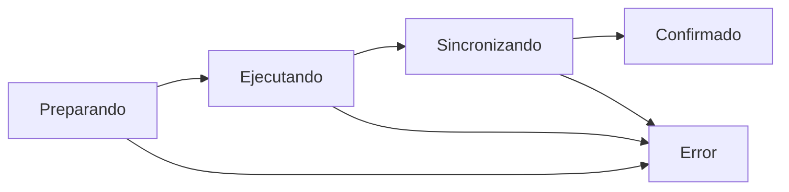

# Deep Living OS — Contrato de telemetría visual y procesos vivos

**Estado:** Implementado parcialmente (núcleo común + Decision Intelligence v0.2). Esta especificación rige nuevas operaciones y extensiones de módulos; no implica telemetría total de procesos externos no instrumentados.

## Objetivo de experiencia
Una interfaz que **muestre trabajo comprobable**: acción iniciada, reglas, ejecución, cambio de estado, obstáculos, finalización y procedencia de resultados. Los pulsos y transiciones solo deben ocurrir cuando el proceso subyacente está activo.

## Componentes integrados
- `OperationPulse.tsx` / `operation-pulse.css`: indicador y grafo compactos de consultas/guardados en el encabezado de Deep Living Pro.
- `App.tsx`: eventos de proceso de `loadWorkspace`, alta y modificación a través del envoltorio `mutation`, incluidas operaciones demo sin persistencia.
- `DecisionIntelligence.tsx`: línea de 5 nodos, porcentaje **medido** de rutas calculadas, estado de 7 alternativas, traza de eventos y resultados visuales.
- `decision-engine.ts`: `runDecisionModelProgressive` utiliza el mismo simulador y agregador que el modo sincrónico. Lotes de 160 simulaciones, semilla estable y AbortController. Emite eventos al finalizar cada lote real. Una ejecución sustituida se cancela.

## Máquina de estados y emisión


Para simulaciones: `validating → filtering → simulating → aggregating → complete`.
Para flujos demo no se afirma persistencia ni sincronización de servidor.
**Regla:** nunca etiquetar una petición como guardada hasta confirmar escritura y refresco. Sin progreso del proveedor, mostrar estado cualitativo, no porcentaje ficticio.

## Contrato recomendado para todos los futuros módulos
```ts
type WorkflowEvent = {
  id: string;
  operation: 'simulacion' | 'propiedad' | 'match' | 'operacion' | 'fuentes' | 'informe';
  action: string; // verbo de negocio, sin PII
  phase: 'pending' | 'running' | 'completed' | 'blocked' | 'failed' | 'cancelled';
  nodeId: string;
  parentNodeId?: string;
  total?: number; // solo si el cómputo conoce la totalidad
  completed?: number; // solo trabajo finalizado realmente
  elapsedMs?: number; // reloj observado, no ETA inferido
  evidenceRef?: string; // identificador autorizado, no URL secreta
  errorCode?: string;
  issuedAt: string;
};
```
La instrumentación durable requiere repositorio de eventos por organización, control de acceso, política de retención y versionado; **no está conectada todavía**. Este documento no autoriza nuevos tipos de datos personales ni fuentes.

## Diseño de interacción
- **Visible:** indicador mínimo de actividad en toda la aplicación, con inspector expandible y último estado.
- **Proceso especializado:** grafo de nodos, conectores activos, hitos, contadores, barra de progreso observada y resultado final.
- **Movimiento:** pulsos en nodo activo, trayectoria en conector activo, revelación secuencial de resultados; evitar brillos constantes en reposo.
- **Semántica:** azul petróleo para trabajo activo, verde para completado, ámbar para revisión, rojo para error/bloqueo. Color nunca como única señal.
- **Ritmo:** cambios de estado inmediatos; no introducir pausas artificiales solo para aparentar trabajo.
- **Accesibilidad:** labels, `aria-valuenow`, navegación por teclado y `prefers-reduced-motion`; nunca emitir decenas de notificaciones en lector de pantalla por segundo.
- **Control:** cancelar/recalcular simulaciones; evitar que resultados antiguos sobrescriban un contexto nuevo.
- **Rendimiento:** no renderizar un nodo por trayectoria simulada; agregar a nivel de lote y resumir historial.

## Pendientes antes de declarar 'todos los procesos'
- Instrumentar avance de operaciones transaccionales, documentos, carga de evidencia, matching y creación de informes según eventos de su propia lógica.
- Persistir trazas no sensibles solo con Supabase RLS verificado, org_id y retención.
- Añadir pruebas E2E de transiciones visuales, interrupción, errores, modo móvil y movimiento reducido.
- Conectar Deep Geo mediante estados verificables de obtención de fuentes, validación, cálculo y revisión.
- Verificar un despliegue navegable antes de anunciar el módulo disponible públicamente.

## No confundir simulación con observación
La progresión del cálculo sí es real; las hipótesis de valores inmobiliarios, riesgos naturales y demanda siguen siendo ficticias hasta contar con fuentes autorizadas y calibración. No generar impresiones de certeza mediante animación.
